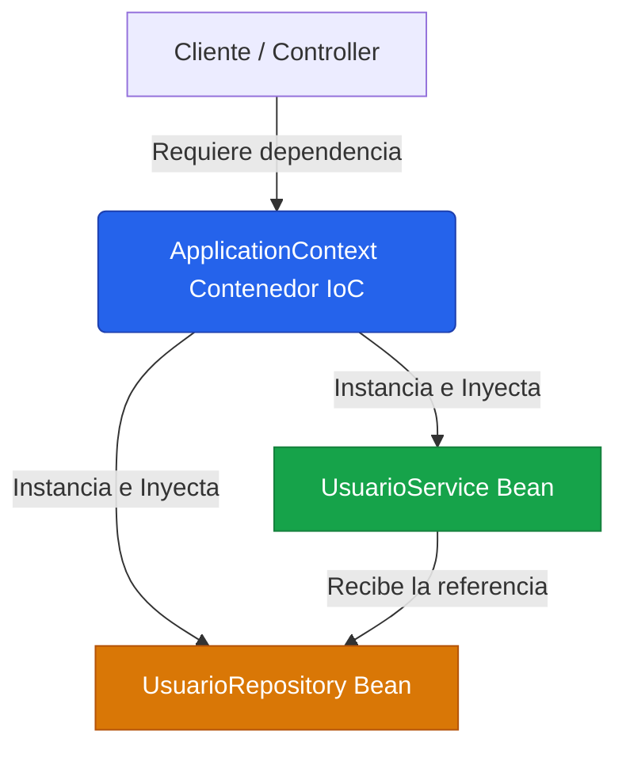
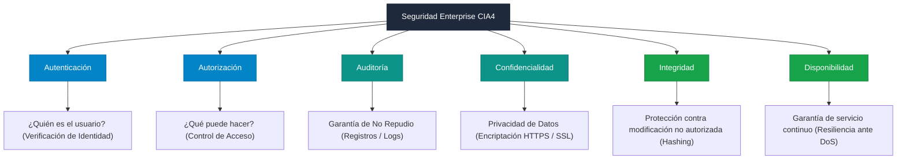
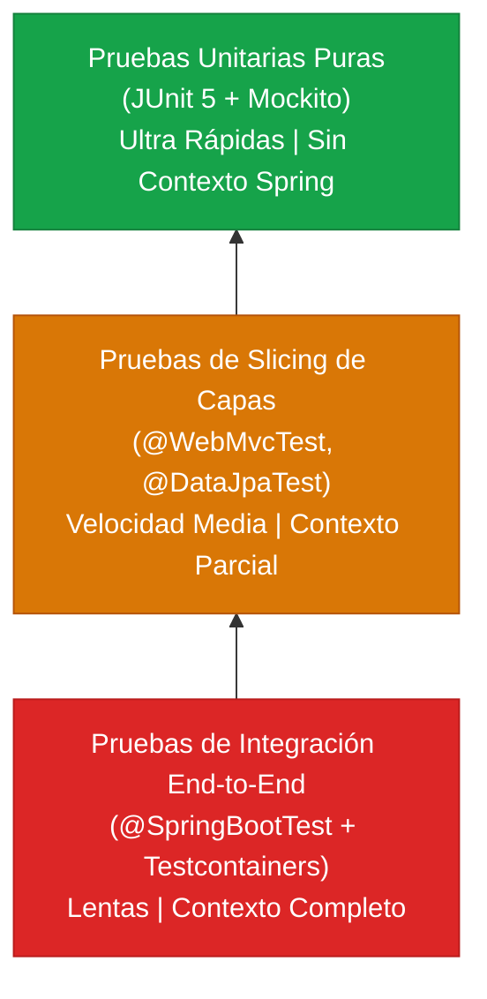
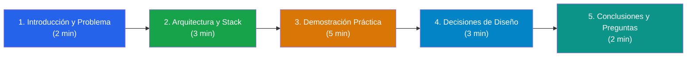

# 📘 Manual de Spring Boot Enterprise para Obsidian
> **Guía Completa de Estudio y Arquitectura**
> **Objetivo**: Preparación intensiva para examen teórico, desarrollo de proyecto práctico y defensa oral.

---

# Módulo 0: Instalación, Configuración del Entorno y Primer Proyecto

## 1. Requisitos Previos y Herramientas del Ecosistema Java
Para desarrollar aplicaciones empresariales robustas con Spring Boot 3.x, se requiere la preparación de tres pilares de entorno:

1. **Java Development Kit (JDK 17 o JDK 21)**: 
   - Se recomienda la distribución LTS **Eclipse Temurin** (de la fundación Adoptium).
   - Verificación en terminal:
     ```bash
     java -version
     javac -version
     ```
2. **Entorno de Desarrollo Integrado (IDE)**:
   - **Visual Studio Code**: Requiere la extensión *Extension Pack for Java* y *Spring Boot Extension Pack*.
   - **IntelliJ IDEA**: Excelente soporte nativo para proyectos Spring Framework.
3. **Gestor de Dependencias y Construcción (Maven / Gradle)**:
   - Utilizaremos **Apache Maven** mediante su ejecutable empaquetado (`mvnw` - Maven Wrapper), lo que garantiza que todo el equipo compile con la misma versión sin necesidad de instalar Maven globalmente.

---

## 2. Generación del Proyecto con Spring Initializr
La forma estándar de inicializar un proyecto Spring Boot es mediante **Spring Initializr** (`start.spring.io`).

> [!TIP]
> **Configuración recomendada para el proyecto de evaluación**:
> - **Project**: Maven
> - **Language**: Java
> - **Spring Boot**: 3.2.x o 3.3.x (versión estable)
> - **Group**: `com.accenture.taskmanager`
> - **Artifact**: `taskmanager`
> - **Name**: `taskmanager`
> - **Package Name**: `com.accenture.taskmanager`
> - **Packaging**: Jar
> - **Java**: 17 o 21
> - **Dependencies**:
>   - *Spring Web* (Capa REST y Servidor Tomcat Embebido)
>   - *Spring Data JPA* (Persistencia ORM)
>   - *H2 Database* (Base de datos relacional en memoria para desarrollo/pruebas)
>   - *Lombok* (Opcional, para reducir código boilerplate de getters/setters)

### Anatomía de la Estructura de Directorios Maven
Al descomprimir el archivo generado, obtenemos la estructura estandarizada de un proyecto empresarial Java:

```text
taskmanager/
├── .mvn/                   # Binarios y configuración del Maven Wrapper
├── src/
│   ├── main/
│   │   ├── java/           # Código fuente Java de producción
│   │   │   └── com/accenture/taskmanager/
│   │   │       └── TaskmanagerApplication.java  # Clase Principal (Punto de entrada)
│   │   └── resources/      # Recursos no Java (Configuración, estáticos, SQL)
│   │       ├── application.properties           # Archivo de propiedades principal
│   │       ├── static/                          # Archivos estáticos (HTML, CSS, JS)
│   │       └── templates/                       # Plantillas de renderizado
│   └── test/
│       └── java/           # Pruebas unitarias e integración
│           └── com/accenture/taskmanager/
│               └── TaskmanagerApplicationTests.java
├── .gitignore
├── mvnw                    # Wrapper de Maven para Linux/macOS (`./mvnw`)
├── mvnw.cmd                # Wrapper de Maven para Windows
└── pom.xml                 # Project Object Model (Gestión de dependencias y plugins)
```

---

## 3. Configuración Mínima y Primera Verificación

Abre el archivo `src/main/resources/application.properties` e incluye la configuración mínima de nombre y puerto:

```properties
# Nombre identificativo de la aplicación Spring
spring.application.name=taskmanager

# Puerto de escucha del servidor web embebido (Tomcat)
server.port=8080

# Configuración de base de datos H2 en memoria para desarrollo
spring.datasource.url=jdbc:h2:mem:taskdb
spring.datasource.driverClassName=org.h2.Driver
spring.datasource.username=sa
spring.datasource.password=
spring.jpa.database-platform=org.hibernate.dialect.H2Dialect
spring.h2.console.enabled=true
```

### Ejecución de la Aplicación
Desde la terminal en la raíz del proyecto, ejecuta:

```bash
# En Linux / macOS:
./mvnw spring-boot:run

# En Windows:
mvnw.cmd spring-boot:run
```

#### Verificación del Servidor HTTP
Abre un navegador web y navega a `http://localhost:8080`.
- **Resultado Esperado**: El navegador mostrará una página de error con código **HTTP 404 (Not Found)** o *Whitelabel Error Page*.
- **Explicación**: Esto confirma que **Tomcat se ha iniciado correctamente en el puerto 8080** y Spring Boot está respondiendo, pero aún no hemos definido ningún controlador (`@RestController`) ni endpoint mapeado en esa ruta.

---

## 4. El Punto de Entrada: `@SpringBootApplication`

En `src/main/java/com/accenture/taskmanager/TaskmanagerApplication.java` encontramos la clase de arranque:

```java
package com.accenture.taskmanager;

import org.springframework.boot.SpringApplication;
import org.springframework.boot.autoconfigure.SpringBootApplication;

@SpringBootApplication
public class TaskmanagerApplication {

    public static void main(String[] args) {
        SpringApplication.run(TaskmanagerApplication.class, args);
    }
}
```

> [!NOTE]
> **Pregunta frecuente de Examen / Entrevista**: ¿Qué tres anotaciones agrupa `@SpringBootApplication`?
>
> 1. **`@SpringBootConfiguration`**: Indica que la clase provee configuración de Beans de Spring (es una especialización de `@Configuration`).
> 2. **`@EnableAutoConfiguration`**: Activa el mecanismo de autoconfiguración de Spring Boot, inspecciona el *classpath* y configura automáticamente los Beans según las librerías detectadas (por ejemplo, configura Tomcat y DispatcherServlet al detectar `spring-boot-starter-web`).
> 3. **`@ComponentScan`**: Activa el escaneo automático de componentes (`@Component`, `@RestController`, `@Service`, `@Repository`) partiendo del paquete donde se ubica esta clase (`com.accenture.taskmanager`) y todos sus subpaquetes.

---

## 5. Control de Versiones Git y Registro de Entregables

Para cumplir con las entregas tipo proyecto (como las actividades formativas de Accenture):
1. Crea la rama correspondiente a la tarea:
   ```bash
   git checkout -b 00-preparacion-del-entorno
   ```
2. Crea una carpeta `notas/` en la raíz del proyecto con un archivo de notas: `notas/NOTAS-00-preparacion-del-entorno.md`.
3. Registra las respuestas a preguntas de diagnóstico y la verificación de arranque antes de abrir el Pull Request (PR).

---


# Módulo 1: Fundamentos Paradigmáticos y Ecosistema Spring Boot

## 1. De POO a POJO, Entidades JPA y DTOs

El desarrollo en la plataforma Java se fundamenta en la distinción entre modelos orientados a objetos y estructuras planas de datos [8].

### Los 4 Pilares de la Programación Orientada a Objetos (POO)
1. **Abstracción**: Selección de atributos y comportamientos relevantes de una entidad real, ignorando los detalles irrelevantes [8].
2. **Encapsulamiento**: Restricción del acceso directo al estado interno de un objeto, exponiendo únicamente métodos públicos controlados (`getters` y `setters`) [8].
3. **Herencia**: Jerarquización y reutilización de código mediante relaciones superclase/subclase [8].
4. **Polimorfismo**: Capacidad de distintas clases de responder de forma diferenciada ante una misma firma de método [8].

---

### ¿Qué es un POJO (*Plain Old Java Object*)?
Un **POJO** identifica una clase Java ordinaria que carece de dependencias directas respecto a frameworks externos o librerías de terceros [8, 9]. 

```java
// Ejemplo de un POJO puro
public class UsuarioPOJO {
    private Long id;
    private String nombre;
    private String email;

    public UsuarioPOJO() {} // Constructor por defecto

    public UsuarioPOJO(Long id, String nombre, String email) {
        this.id = id;
        this.nombre = nombre;
        this.email = email;
    }

    // Getters y Setters
    public Long getId() { return id; }
    public void setId(Long id) { this.id = id; }
    public String getNombre() { return nombre; }
    public void setNombre(String nombre) { this.nombre = nombre; }
    public String getEmail() { return email; }
    public void setEmail(String email) { this.email = email; }
}
```

- **Independencia Tecnológica**: Un POJO no extiende clases base de frameworks ni implementa interfaces de infraestructura especializada, limitándose a tipos del JDK [8, 9].
- **Portabilidad y Testabilidad**: Otorga alta portabilidad y simplifica la ejecución de pruebas unitarias al no requerir contenedores de ejecución complejos [8, 9].

---

### Variantes Especializadas: Entidades JPA vs. DTOs vs. Spring Beans

En arquitecturas enterprise modernas, los POJOs han evolucionado según la capa del sistema en la que operan [8, 10]:

1. **Entidad de Persistencia JPA (`Entity`)**: POJO especializado con anotaciones de mapeo objeto-relacional (ORM) para vincular sus atributos directamente con las columnas de una tabla en la base de datos [8, 10].
2. **Objeto de Transferencia de Datos (`DTO`)**: POJO diseñado exclusivamente para transportar información entre capas o a través de la red en peticiones REST, aislando la estructura de persistencia interna y evitando exponer datos sensibles (como contraseñas) [8, 10].
3. **Spring Managed Bean**: Componente instanciado, configurado y administrado por el contenedor de Inversión de Control de Spring [8, 11].

#### Tabla Comparativa de Componentes Java Enterprise

| Tipo de Componente | Propósito Arquitectónico | Dependencia de Frameworks | Naturaleza de Métodos y Comportamiento |
| :--- | :--- | :--- | :--- |
| **POJO** | Representación plana de modelos conceptuales y estructuras de datos simples [8, 11]. | **Nula**. Exclusivamente Java Standard Edition (JDK) [8, 9]. | Acceso mediante getters/setters; carece de comportamiento de infraestructura [8, 9]. |
| **Entidad JPA** | Mapeo objeto-relacional directo con tablas de la base de datos [8, 10, 11]. | **Alta**. Acoplado a Jakarta Persistence (JPA/Hibernate) [8, 10]. | Mapeo de columnas y relaciones; excluye lógica de transporte API REST [8, 10]. |
| **DTO (Data Transfer Object)** | Contrato estable para transporte de datos en peticiones/respuestas HTTP [8, 10, 11]. | **Nula o baja**. Puede incluir anotaciones de validación [8, 11]. | Contenedor de atributos serializables; no posee lógica de persistencia relacional [8, 10]. |
| **Spring Managed Bean** | Componente administrado por el contenedor de Inversión de Control de Spring [8, 11]. | **Alta**. Dependiente del ciclo de vida del contenedor Spring [8, 12]. | Inyección de dependencias, orquestación de servicios y controladores REST [8, 11]. |

---

## 2. Inversión de Control (IoC) e Inyección de Dependencias (DI)

### El Problema del Acoplamiento Rígido
El desarrollo convencional en Java exige instanciar dependencias manualmente con el operador `new` [8, 12]:

```java
// ❌ MAL: Acoplamiento rígido e imposible de mockear en pruebas
public class UsuarioService {
    private UsuarioRepository repository = new UsuarioRepository(); 
}
```

### Inversión de Control (IoC) y `ApplicationContext`
Bajo el paradigma de **Inversión de Control (IoC)**, la responsabilidad de gestionar el ciclo de vida, configuración e instanciación de los objetos (denominados **Beans**) se traslada desde el código de la aplicación hacia un contenedor central: el **`ApplicationContext`** de Spring [8, 12, 376].

### Inyección de Dependencias (DI) y la anotación `@Autowired`
La **Inyección de Dependencias (DI)** es el mecanismo mediante el cual el contenedor IoC suministra a un componente las instancias de los objetos que requiere en tiempo de ejecución [8, 13, 88].



#### Formas de Implementar Inyección de Dependencias:
1. **Inyección por Atributo (`@Autowired`)**:
   ```java
   // ⚠️ Desaconsejado en código de producción
   @RestController
   public class UsuarioController {
       @Autowired
       private UsuarioService usuarioService;
   }
   ```
2. **Inyección por Constructor (BUENA PRÁCTICA RECOMENDADA)**:
   ```java
   // ✅ RECOMENDADO: Garantiza inmutabilidad y facilita pruebas unitarias
   @RestController
   public class UsuarioController {
       private final UsuarioService usuarioService;

       public UsuarioController(UsuarioService usuarioService) {
           this.usuarioService = usuarioService;
       }
   }
   ```

> [!IMPORTANT]
> **Beneficios de la Inyección por Constructor**:
> - Permite definir los atributos como `final` (inmutabilidad) [8, 13].
> - Evita errores en tiempo de ejecución (`NullPointerException`) si se olvida instanciar una dependencia [8, 13].
> - Permite inyectar fácilmente dobles de prueba (*mocks* con Mockito) sin levantar el contexto de Spring [8, 13, 88].

### Principios SOLID Respaldados por IoC/DI
El patrón de Inyección de Dependencias en Spring permite implementar directamente dos principios SOLID clave [88]:
1. **Interface Segregation Principle (ISP)**: Los clientes no deben estar obligados a depender de interfaces que no utilizan [88].
2. **Dependency Inversion Principle (DIP)**: Módulos de alto nivel no deben depender de módulos de bajo nivel; ambos deben depender de abstracciones (interfaces) [8, 88, 375].

---

## 3. Los 3 Pilares de Spring Boot

Spring Boot erradica la complejidad de la configuración manual XML o Java Config basándose en tres pilares operacionales [8, 14]:

1. **Starters de Dependencias (`spring-boot-starter-*`)**:
   - Módulos que agrupan y gestionan de forma centralizada todas las librerías necesarias para una función específica, garantizando la compatibilidad de versiones (*BOM*) [8, 14].
2. **Autoconfiguración (`@EnableAutoConfiguration`)**:
   - Inspecciona el *classpath* de la aplicación y configura automáticamente los Beans de infraestructura necesarios [8, 14].
3. **Servidores Web Embebidos (Apache Tomcat / Jetty)**:
   - Integración directa del servidor de aplicaciones dentro del archivo ejecutable JAR, eliminando la necesidad de desplegar archivos WAR en servidores externos [8, 14].

---


# Módulo 2: Arquitectura Multicapa Enterprise (*Layered Architecture*)

## 1. El Flujo de Vida de una Petición HTTP

Las aplicaciones empresariales basadas en Spring Boot se estructuran siguiendo una **Arquitectura en Capas (*Layered Architecture*)**, donde cada estrato posee una función especializada y solo se comunica de forma descendente con la capa adyacente [8, 15, 16].

```mermaid
sequenceDiagram
    autonumber
    actor Cliente as Cliente HTTP / Frontend
    participant Controller as Capa Presentación (@RestController)
    participant Service as Capa Negocio (@Service)
    participant Repository as Capa Persistencia (@Repository)
    database BD as Base de Datos Relacional

    Cliente->>Controller: Petición HTTP (JSON + URL + Método)
    Note over Controller: Deserializa JSON a DTO<br/>Valida sintaxis (@Valid)
    Controller->>Service: Invoca método pasando DTO
    Note over Service: Ejecuta reglas de dominio<br/>Transforma DTO a Entidad JPA<br/>Aplica @Transactional
    Service->>Repository: Invocación de método de persistencia
    Repository->>BD: Ejecuta consulta SQL / JPQL
    BD-->>Repository: Devuelve registros / Filas
    Repository-->>Service: Retorna Entidad JPA
    Note over Service: Convierte Entidad a DTO Respuesta
    Service-->>Controller: Retorna DTO Respuesta
    Note over Controller: Envuelve en ResponseEntity<T>
    Controller-->>Cliente: Respuesta HTTP (JSON + Status Code 200/201)
```

---

## 2. Capa de Presentación (`Controller`)

Actúa como el punto de entrada de las peticiones remotas [8, 16]. Sus clases se anotan con `@RestController` y mapean rutas de servicio [8, 16].

### Anotaciones Principales y Mapeos HTTP
- **`@RestController`**: Combina `@Controller` y `@ResponseBody`, indicando que el valor devuelto por cada método se serializará directamente a JSON [8, 16, 195].
- **`@RequestMapping("/api/v1/tareas")`**: Define el prefijo de ruta base para la API.
- **Mapeos de Métodos HTTP**:
  - `@GetMapping`: Consultas y lectura de recursos [8, 16].
  - `@PostMapping`: Creación de nuevos recursos [8, 16].
  - `@PutMapping`: Actualización completa de recursos [8, 16].
  - `@DeleteMapping`: Borrado de recursos [8, 16].

### Captura de Parámetros y Retorno Estandarizado
- **`@RequestBody`**: Extrae y deserializa el cuerpo de la petición JSON hacia un DTO [8, 16].
- **`@PathVariable`**: Extrae valores dinámicos incluidos en la URI (ej. `/tareas/{id}`) [8, 16].
- **`@RequestParam`**: Captura parámetros de consulta en la URL (ej. `/tareas?estado=COMPLETADA`) [8, 16].
- **`ResponseEntity<T>`**: Encapsula la respuesta HTTP, permitiendo especificar el código de estado (`200 OK`, `201 Created`, `404 Not Found`) y los encabezados [8, 16].

```java
@RestController
@RequestMapping("/api/v1/tareas")
public class TareaController {

    private final TareaService tareaService;

    public TareaController(TareaService tareaService) {
        this.tareaService = tareaService;
    }

    @PostMapping
    public ResponseEntity<TareaResponseDTO> crearTarea(@Valid @RequestBody TareaRequestDTO request) {
        TareaResponseDTO nuevaTarea = tareaService.crear(request);
        return ResponseEntity.status(HttpStatus.CREATED).body(nuevaTarea);
    }

    @GetMapping("/{id}")
    public ResponseEntity<TareaResponseDTO> obtenerPorId(@PathVariable Long id) {
        return ResponseEntity.ok(tareaService.obtenerPorId(id));
    }
}
```

---

## 3. Capa de Negocio (`Service`)

Concentra las reglas del dominio, validaciones avanzadas y la orquestación de transacciones [8, 17].

### Reglas de Dominio y Anotación `@Transactional`
- **`@Service`**: Anota la clase como componente de servicio en el contenedor IoC [8, 17].
- **`@Transactional`**: Asegura que todas las operaciones dentro del método se ejecuten dentro de un contexto de transacción atómico (ACID) [8, 17]. Si se produce una excepción en tiempo de ejecución (`RuntimeException`), se ejecuta un *rollback* automático de las operaciones en la base de datos [8, 17].
- **`@Transactional(readOnly = true)`**: Optimiza el rendimiento en operaciones de lectura al evitar el cálculo de cambios de Hibernate (*dirty checking*) [281, 282].

```java
@Service
public class TareaServiceImpl implements TareaService {

    private final TareaRepository tareaRepository;
    private final TareaMapper tareaMapper;

    public TareaServiceImpl(TareaRepository tareaRepository, TareaMapper tareaMapper) {
        this.tareaRepository = tareaRepository;
        this.tareaMapper = tareaMapper;
    }

    @Override
    @Transactional
    public TareaResponseDTO crear(TareaRequestDTO dto) {
        // 1. Regla de negocio: Validar duplicados
        if (tareaRepository.existsByTitulo(dto.getTitulo())) {
            throw new ReglaNegocioException("Ya existe una tarea con el mismo título");
        }
        // 2. Mapear DTO a Entidad
        TareaEntity entidad = tareaMapper.toEntity(dto);
        // 3. Persistir en base de datos
        TareaEntity guardada = tareaRepository.save(entidad);
        // 4. Retornar DTO de respuesta
        return tareaMapper.toDTO(guardada);
    }

    @Override
    @Transactional(readOnly = true)
    public TareaResponseDTO obtenerPorId(Long id) {
        TareaEntity entidad = tareaRepository.findById(id)
                .orElseThrow(() -> new RecursoNoEncontradoException("Tarea no encontrada con ID: " + id));
        return tareaMapper.toDTO(entidad);
    }
}
```

---

## 4. Capa de Persistencia (`Repository`)

Administra la comunicación con la base de datos mediante **Spring Data JPA** [8, 18].

### `JpaRepository` y Derivación Automática de Consultas (*Query Methods*)
Al extender `JpaRepository<TareaEntity, Long>`, Spring Data proporciona de forma automática métodos CRUD como `save()`, `findById()`, `findAll()`, `deleteById()` sin necesidad de escribir consultas SQL [8, 18, 241, 242].

Además, permite crear consultas personalizadas basadas en el nombre del método:

```java
@Repository
public interface TareaRepository extends JpaRepository<TareaEntity, Long> {

    // Query Method derivado automáticamente por Spring Data JPA
    boolean existsByTitulo(String titulo);

    List<TareaEntity> findByEstado(String estado);

    // Consulta personalizada mediante JPQL si la derivación automática no es suficiente
    @Query("SELECT t FROM TareaEntity t WHERE t.fechaVencimiento < :fecha AND t.completada = false")
    List<TareaEntity> findTareasVencidas(@Param("fecha") LocalDate fecha);
}
```

---

## 5. Delimitación Estricta y Buenas Prácticas Por Capa

| Capa Arquitectónica | Anotaciones Principales | Responsabilidades Permitidas | Prohibiciones Estrictas |
| :--- | :--- | :--- | :--- |
| **Presentación (Controller)** | `@RestController`, `@RequestMapping` [8, 19] | Captura de peticiones HTTP, validación inicial sintáctica, retorno de DTOs en `ResponseEntity` [8, 16, 19]. | **Prohibido** consultar repositorios directamente o implementar reglas de negocio [8, 19]. |
| **Negocio (Service)** | `@Service`, `@Transactional` [8, 17, 19] | Reglas de dominio, orquestación transaccional, conversión Entidades ↔ DTOs [8, 15, 17, 19]. | **Prohibido** importar clases de la API de Servlets (ej. `HttpServletRequest`) [8, 19]. |
| **Persistencia (Repository)** | `@Repository` [8, 18, 19] | Mapeo y ejecución de operaciones CRUD sobre la base de datos relacional [8, 18, 19]. | **Prohibido** gestionar reglas de negocio o manipular DTOs directamente [8, 19]. |
| **Dominio (Entity)** | `@Entity`, `@Table`, `@Id` [8, 19] | Mapeo objeto-relacional del esquema de base de datos [8, 10, 19]. | **Prohibido** retornar entidades directamente en las respuestas HTTP de la API REST [8, 10, 19]. |

---


# Módulo 3: Organización del Proyecto y Estructura de Paquetes

## 1. Estrategias de Empaquetado: Capas vs. Dominio/Funcionalidades

La organización de los paquetes determina la legibilidad y mantenibilidad del software enterprise a largo plazo [8, 20].

```text
Estructura por Capas (Layer-based)           Estructura por Funcionalidad (Feature-based)
com.accenture.taskmanager/                   com.accenture.taskmanager/
├── controller/                              ├── usuario/
│   ├── UsuarioController.java                   │   ├── UsuarioController.java
│   └── TareaController.java                     │   ├── UsuarioService.java
├── service/                                 │   ├── UsuarioRepository.java
│   ├── UsuarioService.java                      │   └── UsuarioEntity.java
│   └── TareaService.java                        ├── tarea/
├── repository/                              │   ├── TareaController.java
│   ├── UsuarioRepository.java                   │   ├── TareaService.java
│   └── TareaRepository.java                     │   ├── TareaRepository.java
└── model/                                   │   └── TareaEntity.java
    ├── UsuarioEntity.java                   └── config/
    └── TareaEntity.java                         └── SecurityConfig.java
```

### 1. Estructura por Capas (*Layer-based Package Structure*)
- **Concepto**: Agrupa los componentes por su rol tecnológico o técnico (`controller`, `service`, `repository`, `model`) [8, 20, 21].
- **Cuándo Usarla**: Ideal para proyectos pequeños o medianos (< 10 recursos REST), monolitos sencillos o proyectos de evaluación/aprendizaje [8, 21, 279].
- **Ventaja**: Curva de aprendizaje baja y localización intuitiva de clases por su anotación [8, 21].
- **Inconveniente**: "Efecto Soplado" (*Bloat*); a medida que el proyecto crece, la carpeta `service` acumula decenas de clases difíciles de navegar [211].

### 2. Estructura por Funcionalidad / Dominio (*Feature-based Package Structure*)
- **Concepto**: Agrupa todos los componentes pertenecientes a una misma funcionalidad de negocio (`usuario`, `tarea`, `facturacion`) dentro del mismo paquete [8, 22, 212].
- **Cuándo Usarla**: Recomendada en sistemas empresariales de gran escala o aplicaciones en evolución modular (*Spring Modulith*) [8, 22, 221].
- **Ventaja**: Alta cohesión y bajo acoplamiento. Permite aislar cambios y facilita la futura migración hacia una arquitectura de microservicios [8, 22, 213, 253].

---

## 2. Mapa Estándar de Paquetes (Convención Recommended)

Para el proyecto de evaluación se recomienda adoptar la estructura por capas estandarizada en la industria [8, 22, 237]:

```text
com.accenture.taskmanager/
├── TaskmanagerApplication.java   # Root Package: activa el @ComponentScan
├── config/                       # Beans de infraestructura, Seguridad, CORS, Swagger
├── controller/                   # Endpoints RESTful (@RestController)
├── service/                      # Interfaces de Servicio
│   └── impl/                     # Implementaciones de la lógica de negocio (@Service)
├── repository/                   # Repositorios JPA (@Repository)
├── model/
│   ├── entity/                   # Entidades mapeadas con la BD (@Entity)
│   └── dto/                      # Contratos de Petición/Respuesta (DTOs)
├── mapper/                       # Componentes de conversión (MapStruct / Mappers)
├── exception/                    # Manejador global de excepciones (@RestControllerAdvice)
└── util/                         # Helper/Utility classes puras
```

> [!WARNING]
> **Regla de Oro del Paquete Raíz (*Root Package*)**:
> La clase principal con la anotación `@SpringBootApplication` DEBE situarse en la raíz del paquete (`com.accenture.taskmanager`). De lo contrario, los paquetes que queden por fuera de su jerarquía no serán detectados por el *Component Scan* y lanzarán la excepción `NoSuchBeanDefinitionException` [8, 21, 181, 312].

---

## 3. Configuración del Entorno y Perfiles (*Spring Profiles*)

Spring Boot permite gestionar configuraciones por entorno mediante archivos de propiedades o YAML externos [257, 258, 286].

### Archivos de Propiedades por Perfil
- `src/main/resources/application.properties` (Configuración base común a todos los entornos) [257, 286].
- `src/main/resources/application-dev.properties` (Entorno de desarrollo con base de datos H2) [257, 286].
- `src/main/resources/application-prod.properties` (Entorno de producción con PostgreSQL/Oracle) [257, 286].

### Activación de Perfiles
Se activa definiendo la propiedad en el archivo base o mediante variable de entorno al arrancar [258, 286]:

```properties
# application.properties
spring.profiles.active=dev
```

Al desplegar el artefacto JAR en producción:
```bash
java -jar app.jar --spring.profiles.active=prod
```

> [!SECURITY]
> **Gestión Segura de Secretos**:
> **NUNCA** guardes contraseñas de bases de datos o claves secretas en archivos dentro de Git [258, 287]. Utiliza variables de entorno:
> ```properties
> spring.datasource.username=${DB_USERNAME}
> spring.datasource.password=${DB_PASSWORD}
> ```

---


# Módulo 4: Construcción de APIs RESTful, Wrapper Estandarizado y Gestión de Errores

## 1. Principios REST y Semántica HTTP

Las **APIs RESTful** (*Representational State Transfer*) se caracterizan por ser apátridas (*stateless*), desacoplar cliente y servidor, y reutilizar la semántica estándar del protocolo HTTP [442, 446]:

| Método HTTP | Propósito | Idempotente | Cuerpos Solicitud/Respuesta | Código HTTP Típico |
| :--- | :--- | :--- | :--- | :--- |
| **`GET`** | Leer o buscar recursos [355]. | **Sí** | Sin body / Devuelve JSON [355]. | `200 OK` |
| **`POST`** | Crear un nuevo recurso [356]. | **No** | Petición JSON / Devuelve JSON [356]. | `201 Created` |
| **`PUT`** | Actualizar completamente un recurso [358]. | **Sí** | Petición JSON / Devuelve JSON [358]. | `200 OK` |
| **`DELETE`** | Eliminar un recurso [359]. | **Sí** | Sin body / Generalmente vacío [359]. | `204 No Content` |

---

## 2. Envoltorio Estandarizado de Respuestas (`ApiResponse<T>`)

Para proporcionar una experiencia homogénea a los clientes de la API (frontend o aplicaciones móviles), es una buena práctica envolver todas las respuestas en una estructura predecible (*Envelope*) [245, 246]:

```java
package com.accenture.taskmanager.model.dto;

import java.time.LocalDateTime;

public class ApiResponse<T> {

    private boolean success;
    private String message;
    private T data;
    private LocalDateTime timestamp;

    public ApiResponse() {}

    public ApiResponse(boolean success, String message, T data) {
        this.success = success;
        this.message = message;
        this.data = data;
        this.timestamp = LocalDateTime.now();
    }

    public static <T> ApiResponse<T> success(T data, String message) {
        return new ApiResponse<>(true, message, data);
    }

    public static <T> ApiResponse<T> error(String message) {
        return new ApiResponse<>(false, message, null);
    }

    // Getters y Setters
    public boolean isSuccess() { return success; }
    public String getMessage() { return message; }
    public T getData() { return data; }
    public LocalDateTime getTimestamp() { return timestamp; }
}
```

#### Estructura JSON Generada:
```json
{
  "success": true,
  "message": "Tarea creada exitosamente",
  "data": {
    "id": 10,
    "titulo": "Implementar JWT",
    "completada": false
  },
  "timestamp": "2026-10-07T14:30:00"
}
```

---

## 3. Manejo Centralizado de Excepciones (`@RestControllerAdvice`)

Evita dispersar bloques `try-catch` en los controladores o exponer trazas de error internas (*stack traces*) al cliente [8, 30, 247].

### Interceptor Global de Excepciones
Mediante un componente anotado con `@RestControllerAdvice`, interceptamos las excepciones lanzadas en cualquier capa del sistema y las convertimos en respuestas JSON con el código de estado HTTP adecuado [8, 30, 247].

```java
package com.accenture.taskmanager.exception;

import com.accenture.taskmanager.model.dto.ApiResponse;
import org.springframework.http.HttpStatus;
import org.springframework.http.ResponseEntity;
import org.springframework.web.bind.MethodArgumentNotValidException;
import org.springframework.web.bind.annotation.ExceptionHandler;
import org.springframework.web.bind.annotation.RestControllerAdvice;

import java.util.HashMap;
import java.util.Map;

@RestControllerAdvice
public class GlobalExceptionHandler {

    // 1. Intercepta Recursos No Encontrados (404)
    @ExceptionHandler(RecursoNoEncontradoException.class)
    public ResponseEntity<ApiResponse<Void>> handleNotFound(RecursoNoEncontradoException ex) {
        ApiResponse<Void> response = ApiResponse.error(ex.getMessage());
        return ResponseEntity.status(HttpStatus.NOT_FOUND).body(response);
    }

    // 2. Intercepta Errores de Validación de DTOs (@Valid) (400)
    @ExceptionHandler(MethodArgumentNotValidException.class)
    public ResponseEntity<ApiResponse<Map<String, String>>> handleValidation(MethodArgumentNotValidException ex) {
        Map<String, String> errores = new HashMap<>();
        ex.getBindingResult().getFieldErrors().forEach(error -> 
            errores.put(error.getField(), error.getDefaultMessage())
        );
        ApiResponse<Map<String, String>> response = new ApiResponse<>(
            false, 
            "Error de validación en los campos ingresados", 
            errores
        );
        return ResponseEntity.status(HttpStatus.BAD_REQUEST).body(response);
    }

    // 3. Captura no controlada (500)
    @ExceptionHandler(Exception.class)
    public ResponseEntity<ApiResponse<Void>> handleGlobal(Exception ex) {
        ApiResponse<Void> response = ApiResponse.error("Ocurrió un error interno en el servidor");
        return ResponseEntity.status(HttpStatus.INTERNAL_SERVER_ERROR).body(response);
    }
}
```

---

## 4. Documentación Interactiva con OpenAPI y Swagger UI

Spring Boot se integra con la librería **Springdoc OpenAPI** para generar documentación interactiva automática de los endpoints [96, 118, 119].

### Dependencia en `pom.xml`:
```xml
<dependency>
    <groupId>org.springdoc</groupId>
    <artifactId>springdoc-openapi-starter-webmvc-ui</artifactId>
    <version>2.3.0</version>
</dependency>
```

### URLs de Acceso tras Arrancar la Aplicación:
- **Interfaz Interactiva Swagger UI**: `http://localhost:8080/swagger-ui/index.html` [118, 119].
- **Especificación JSON OpenAPI**: `http://localhost:8080/v3/api-docs` [118, 120].

---

### Swagger (OpenAPI) vs Javadoc: ¿En qué capa se usa cada uno?

| Criterio | Swagger (OpenAPI 3) | Javadoc |
| :--- | :--- | :--- |
| **Público objetivo** | Clientes externos (Frontend React/Angular, apps móviles, terceros). | Desarrolladores Java que leen y mantienen el código interno. |
| **Capa de aplicación** | **Exclusivamente en Capa Controlador (`@RestController`) y DTOs**. | **Principalmente en Capa Servicio (`@Service`)** y clases de utilidad. |
| **Propósito** | Describir contratos HTTP (rutas, verbos, parámetros, códigos 200/404, payloads). | Explicar lógica de métodos (`@param`, `@return`, `@throws`) en el IDE. |
| **Regla de oro** | **Nunca** colocar anotaciones de Swagger en `@Service` o `@Entity` (rompe capas). | Esencial en interfaces y reglas complejas de negocio. |

---

### Perfiles de Maven vs Perfiles de Spring: ¿Por qué "se pisan"?

1. **Perfil de Spring (en tiempo de ejecución):**
   - El `.jar` empaquetado incluye todos los archivos (`application-dev.yml`, `application-prod.yml`).
   - Se activa al ejecutar: `java -jar app.jar --spring.profiles.active=prod`.
   - *Riesgo:* El `.jar` contiene contraseñas o configuraciones de otros entornos.

2. **Perfil de Maven (en tiempo de compilación / build):**
   - Se activa al compilar: `mvn clean package -P prod`.
   - Maven filtra los recursos y **excluye** los archivos de desarrollo del `.jar` final.
   - El artefacto de producción queda 100% blindado y aislado.

3. **¿Por qué los perfiles "se pisan"? (Herencia en cascada):**
   - Existe un fichero o bloque base (`application.yml`) con las configuraciones compartidas.
   - Al activar un perfil específico (`application-prod.yml`), las propiedades definidas en él **tienen mayor prioridad y sobreescriben ("pisan")** las de la base.
   - Lo que no se redefina en el perfil específico se hereda automáticamente de la base, evitando duplicación innecesaria.

4. **Relación con Jenkins (CI/CD):**
   - En entornos corporativos, **Jenkins automatiza la construcción y despliegue**:
     1. El desarrollador hace `git push` a la rama de lanzamiento (`main` o `release`).
     2. Jenkins detecta el cambio, pasa los tests (`mvn test`) y compila para producción:
        `mvn clean package -P prod -DskipTests=false`
     3. Jenkins inyecta contraseñas reales de producción almacenadas en su gestor de credenciales seguro (*Jenkins Credentials / Vault*).
     4. Maven empaqueta únicamente la configuración de producción y Jenkins despliega el `.jar` resultante en el servidor o contenedor Docker.

---


# Módulo 5: Seguridad e Integridad de la Aplicación

## 1. Fundamentos de Seguridad: El Modelo CIA4

La seguridad del software es la práctica de proteger las aplicaciones contra ataques maliciosos para garantizar que continúen funcionando como se espera [391].

La seguridad en aplicaciones Java Enterprise descansa en 6 pilares esenciales (**Modelo CIA4**) [391]:



1. **Autenticación (Authentication)**: Proceso de verificar la identidad única del cliente o usuario ("¿Quién eres?") [391].
2. **Autorización (Authorization)**: Proceso que gobierna los recursos y operaciones permitidas para un usuario autenticado ("¿Qué tienes permitido hacer?") [392].
3. **Auditoría (Auditing)**: Registro de actividades para garantizar el *no repudio* (el usuario no puede negar haber realizado una transacción) [392].
4. **Confidencialidad (Confidentiality)**: Garantía de que los datos permanecen privados y no pueden ser leídos por usuarios no autorizados (uso de cifrado TLS/HTTPS y hash de passwords) [349, 392].
5. **Integridad (Integrity)**: Protección contra la modificación accidental o maliciosa de datos en tránsito o almacenamiento (firmas digitales y MACs) [350, 393].
6. **Disponibilidad (Availability)**: Garantía de que los servicios permanecen accesibles a los usuarios legítimos frente a intentos de interrupción [393].

---

## 2. Prevención de Vulnerabilidades y Ataques Comunes

### 1. Inyección SQL (SQL Injection - SQLi)
- **Mecanismo de Ataque**: Ocurre cuando se insertan fragmentos de código SQL maliciosos a través de campos de entrada no sanitizados en la aplicación, alterando la intención de la consulta original [465].
- **Efectos**: Lectura no autorizada de datos sensibles, modificación o destrucción de tablas y bypass de autenticación [465].

#### Prevención en Java y Spring Boot:
- **`PreparedStatement` (Consultas Parametrizadas)**:
  La base de datos distingue estrictamente entre la estructura del código SQL y los datos de entrada [467].
  ```java
  // ❌ VULNERABLE a SQL Injection (Concatenación directa):
  String query = "SELECT * FROM usuarios WHERE email = '" + inputUsuario + "'";

  // ✅ SEGURO (Prepared Statement con parámetros):
  String sql = "SELECT * FROM usuarios WHERE email = ?";
  PreparedStatement stmt = connection.prepareStatement(sql);
  stmt.setString(1, inputUsuario);
  ```
- **Spring Data JPA**: Las consultas generadas mediante *Query Methods* o anotadas con `@Query` utilizando parámetros con nombre (`:param`) emplean internamente `PreparedStatement` y son inmunes a inyecciones SQL estándar [467].

---

### 2. Cross-Site Scripting (XSS)
- **Mecanismo**: Inyección de scripts maliciosos (generalmente JavaScript) en páginas web dinámicas vistas por otros usuarios [368].
- **Tipos**:
  - *Reflejado (Non-Persistent)*: La entrada no sanitizada se devuelve inmediatamente en la respuesta HTTP [368].
  - *Almacenado (Persistent)*: El script malicioso se guarda en la base de datos y se ejecuta cada vez que un usuario visualiza el registro [368].
- **Mitigación**: Validar y sanitizar las entradas en el controlador (`@Valid`), encodear las salidas dinámicas e implementar políticas de seguridad de contenido (CSP) en las cabeceras HTTP.

---

### 3. Ataques de Denegación de Servicio (DoS / DDoS)
- **Mecanismo**: Inundación de tráfico o peticiones maliciosas dirigidas a agotar los recursos de cómputo (CPU, memoria, conexiones a la BD) e inactivar el servicio [378, 379].
- **Variantes**: *Buffer Overflow*, *SYN Flood* (inundación de conexiones TCP abiertas) e *ICMP Ping Flood* [379].
- **Mitigación**:
  - Configuración de límites de tasa (*Rate Limiting*) en gateway.
  - Uso de balanceadores de carga (*Load Balancers*) [381].
  - Configuración de cortafuegos (Firewalls) e infraestructura redundante [381].

---

### 4. Seguridad de Sesiones y Estado
- El protocolo HTTP es apátrida (*stateless*) [390, 483, 484]. 
- En APIs REST se recomienda utilizar **autenticación basada en Tokens (JWT - JSON Web Tokens)** transmitidos sobre HTTPS, evitando cookies persistentes o estado de sesión en el servidor para prevenir ataques de *Cookie Poisoning* o *Session Hijacking* [350, 484, 488].

---


# Módulo 6: Pruebas de Software, Metodologías Ágiles, Contexto IA y Defensa del Proyecto

## 1. Estrategias de Testing en Spring Boot

El testing en Spring Boot sigue la pirámide de pruebas, dividiéndose en pruebas unitarias aceleradas y pruebas de integración [125, 126, 287].



### 1. Pruebas Unitarias Puras (Service / Domain)
Verifican la lógica de negocio en aislamiento completo utilizando **JUnit 5** y simulación de dependencias con **Mockito** (`mock()`, `when()`, `verify()`) [126, 127].

```java
class TareaServiceTest {

    @Test
    void debeObtenerTareaPorIdExitosamente() {
        // Given (Dado un escenario)
        TareaRepository repositoryMock = mock(TareaRepository.class);
        TareaMapper mapperMock = mock(TareaMapper.class);
        
        TareaEntity entidad = new TareaEntity(1L, "Estudiar Spring", false);
        TareaResponseDTO dtoEsperado = new TareaResponseDTO(1L, "Estudiar Spring", false);

        when(repositoryMock.findById(1L)).thenReturn(Optional.of(entidad));
        when(mapperMock.toDTO(entidad)).thenReturn(dtoEsperado);

        TareaServiceImpl service = new TareaServiceImpl(repositoryMock, mapperMock);

        // When (Cuando se ejecuta la acción)
        TareaResponseDTO resultado = service.obtenerPorId(1L);

        // Then (Entonces se verifican los resultados)
        assertNotNull(resultado);
        assertEquals("Estudiar Spring", resultado.getTitulo());
        verify(repositoryMock).findById(1L);
    }
}
```

### 2. Pruebas de Integración y Slicing de Capas
- **`@WebMvcTest(TareaController.class)`**: Carga únicamente la capa Web (Controladores, JSON, validaciones) e inyecta servicios simulados mediante `@MockBean` [287].
- **`@DataJpaTest`**: Carga únicamente los componentes de persistencia (repositorios JPA e Hibernate) utilizando la base de datos H2 en memoria [287].
- **`@SpringBootTest`**: Carga el contexto completo de la aplicación para validar el flujo punta a punta [128, 287].

---

## 2. Metodologías TDD y BDD

### Test Driven Development (TDD)
Proceso de desarrollo que repite un ciclo corto de 3 fases: **Red ➔ Green ➔ Refactor** [495, 496]:
1. **Red**: Escribir una prueba unitaria que falle antes de implementar la funcionalidad [496].
2. **Green**: Escribir el código mínimo estrictamente necesario para que la prueba pase [496].
3. **Refactor**: Mejorar el diseño y la estructura del código manteniendo la prueba en verde [496].

### Behavior Driven Development (BDD)
Evolución de TDD orientada a especificar el comportamiento del software en lenguaje natural mediante escenarios estructurados **Given - When - Then** [344, 345, 346]:
- **Given** (Dado): Contexto inicial o precondición.
- **When** (Cuando): Evento o acción realizada por el usuario.
- **Then** (Entonces): Resultado o comportamiento esperado.

---

## 3. Protocolos de Documentación y Contexto IA (`PROJECT.md` y `AGENTS.md`)

En entornos de desarrollo asistidos por Inteligencia Artificial (Copilot, Cursor, Claude Code, VS Code), es imprescindible estandarizar la documentación de contexto en la raíz del repositorio [23, 24, 137].

```text
taskmanager/
├── PROJECT.md     # Mapa del proyecto, arquitectura y límites para humanos e IA
├── AGENTS.md      # Instrucciones de comandos, build, tests y reglas para agentes de código
└── pom.xml
```

### Diferencias Fundamentales

| Archivo | Destinatario Principal | Secciones Clave | Propósito Funcional |
| :--- | :--- | :--- | :--- |
| **`PROJECT.md`** | Desarrolladores Humanos e Inteligencias Artificiales [25, 139]. | Propósito del producto, Stack tecnológico, Mapa de arquitectura, Límites de cambio seguro [25, 142]. | Proporciona un mapa duradero del proyecto para evitar que la IA sugiera patrones incompatibles [25, 137]. |
| **`AGENTS.md`** | Agentes de Código Autónomos e IDEs Inteligentes [25, 34]. | Comandos de build/test, reglas de formato, convenciones de código, verificaciones antes del commit [25, 38]. | Proporciona instrucciones operativas concretas que el agente ejecuta para verificar los cambios [25, 38]. |

---

## 4. Guía Práctica para la Exposición Oral del Proyecto Técnico

Para defender tu proyecto con éxito ante el tribunal o evaluadores técnicos, se recomienda estructurar la exposición de 10 a 15 minutos en **5 bloques estratégicos**:



### Estructura de la Defensa Oral:
1. **Bloque 1: Problema y Contexto de Negocio (2 minutos)**:
   - Presenta la necesidad funcional que resuelve tu proyecto (ej. "TaskManager para la gestión centralizada de tareas críticas").
2. **Bloque 2: Arquitectura y Decisiones Técnicas (3 minutos)**:
   - Muestra el diagrama de la **Arquitectura Multicapa** (Controller ➔ Service ➔ Repository ➔ DB).
   - Justifica la elección del stack: Java 17/21, Spring Boot 3, Spring Data JPA, H2 y Swagger.
   - Explica la separación de **Entidades vs. DTOs** para proteger el modelo de base de datos.
3. **Bloque 3: Demostración en Vivo / Flujo Principal (5 minutos)**:
   - Muestra la ejecución de los endpoints a través de **Swagger UI** (`http://localhost:8080/swagger-ui/index.html`).
   - Demuestra la creación de un recurso (HTTP POST) y su consulta (HTTP GET).
   - Provoca un error intencional (ej. validación DTO fallida) para mostrar el manejo global de excepciones (`@RestControllerAdvice`).
4. **Bloque 4: Seguridad, Buenas Prácticas y Pruebas (3 minutos)**:
   - Explica cómo se previenen ataques de **Inyección SQL** gracias a `JpaRepository` y `PreparedStatement`.
   - Muestra la suite de pruebas unitarias ejecutadas con JUnit y Mockito en verde (`mvn test`).
5. **Bloque 5: Conclusión y Preguntas (2 minutos)**:
   - Resume los logros clave y muestra cómo los archivos `PROJECT.md` y `AGENTS.md` permitieron mantener un código limpio y estructurado.

---


